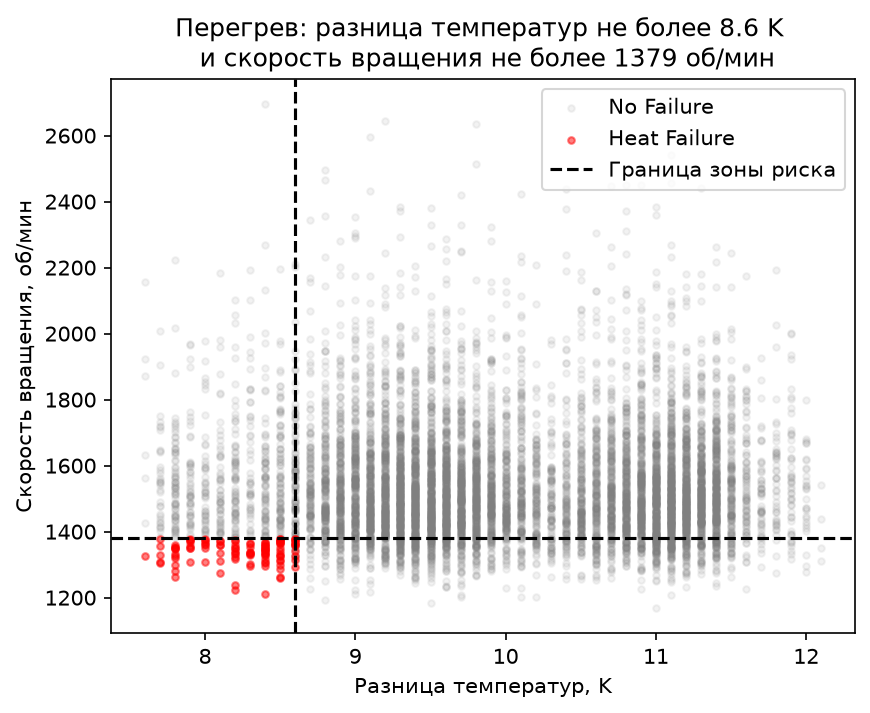
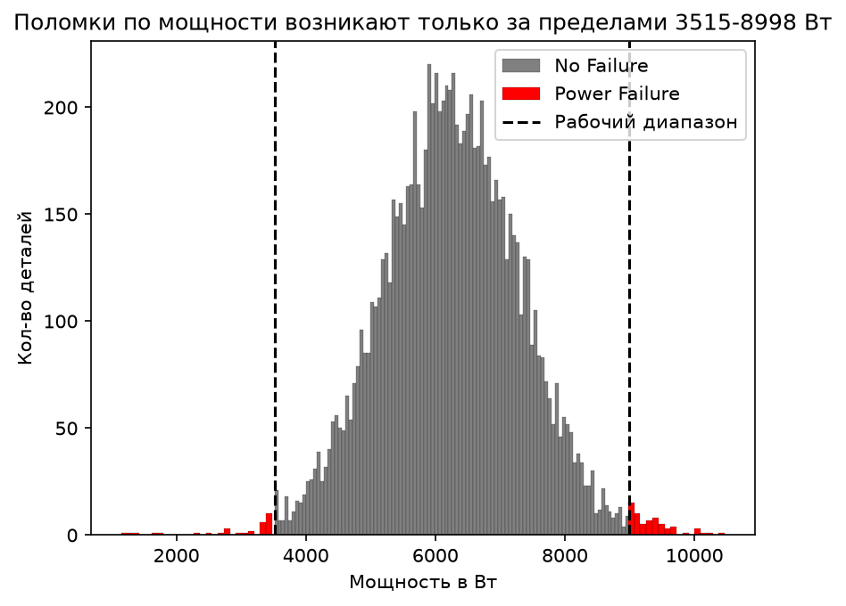

## Анализ причин поломок промышленных станков на синтетическом датасете 

## Очистка данных
При анализе таблицы predictive_maintenance была замечена неточность в кол-ве поломок, отмеченных в колонке target.
- 339 по колонке target
- 348 по колонке failure_type
Колонка target не учитывала Random Failures как поломку, а также, ошибочно определяла 9 No Failure как поломку.
- 9 строк с No Failure были удалены т.к. непонятно какой колонке верить
- 18 строк с Random Failures были отмечены как поломка в новой колонке is_failure
Итого в таблице стало 9991 строк из 10000 и 348 поломок.

## Анализ поломки из за перегрева SQL. 

Перегрев - самый частый тип поломки. 112 из 348 = 32% всех поломок.
Было определено, что низкая разница температур  <= 8.60 и низкая скорость вращения <= 1379 по отдельности не объясняют поломку
- 676 успешных деталей при низкой разнице и 1139 успешных деталей при низкой скорости.
Поломка возникает когда оба этих фактора складываются вместе.
При temp_diff <= 8.60 и rotational_speed <= 1379 было поймано 112 из 112 поломок
Все перегревы произошли при сочетании низкой разницы температур и низкой скорости.
Доля верных тревог 112 из 130 обнаруженных, что соответствует ~86%.
18 остальных тревог: 13 нормальных, 4 из за мощности и 1 из за напряжения. Все, кроме 3 по мощности, исчезают при temp_diff < 8.60, но в таком случае мы теряем еще 12 поломок из за перегрева.
Я считаю, что следует оставить temp_diff <= 8.60, при условии, что 12 поломок стоят дороже, чем 13 ложных тех. обслуживаний.
. 

## Анализ поломки из за мощности Pandas. 

Мощность - 95 из 348 = 27% всех поломок.
Анализ значений мощности показал больший размах при поломке по сравнению с нормальными значениями.
Далее было выяснено, что все 95 поломок лежат за пределами нормального размаха, а именно менее 3515.03 Вт и более 8998.02 Вт.
Среднее значение обманывало т.к. поломки происходили с двух сторон диапазона. 31 из 95 поломок произошли от недостатка мощности, а остальные 64 от избытка.
Важно то, что по данному критерию не попала ни одна другая причина. 95 из 95 найденных результатов принадлежат поломкам по мощности. 

## Анализ поломки из за перегрузки Pandas.

Механическая перегрузка 78 из 348 = 22% всех поломок
Первичный анализ показал, что при поломке среднее значение крутящего момента 56.9 против 39.6 у нормальных, при разбросе 9.5 у нормальных, то есть почти на 2 стандартных отклонения выше.
Но крутящий момент сам по себе поломку не объясняет, т.к. 2388 нормальных деталей были сделаны при значениях выше 56.9.
Износ инструмента в среднем был в 2 раза больше при поломках 208 к 106. Связь данных значений хоть и ловила все 78 поломок, но вместе с ними попадали 380 нормальные детали.
После построения графика  на котором было видно, что поломки идут по дуге, было решено фильтровать по произведению этих значений.
В результате удалось снизить ошибочно попавшие нормальные детали до 23х. Далее путем разделения деталей по типу, были найдены индивидуальные границы значений учитывая 
тип детали - L выше 11 003, M выше 12 383, H выше 13 235. Для детали типа H порог грубый т.к. произошла только одна поломка.
Данный подход позволил полностью убрать ложные срабатывания и поймал 97 поломок, 78 из за механической перегрузки и 19 других типов.

## Анализ поломки из за износа интрумента

При анализе было выявлено, что при поломке, среднее значение износа равно 206, но оно не объясняло причину поломки, т.к. 723 детали были высечены нормально в том же диапазоне износа.
Явной границы у данной причины нет т.к. риск поломки возрастает с износом. После 200 минут работы меняется только вероятность поломки, с 4% до 16%.
Рекомендуется просто менять инструмент после 200 минут работы, т.к. каждые 10 минут после, шанс, что он выйдет из строя возрастает.